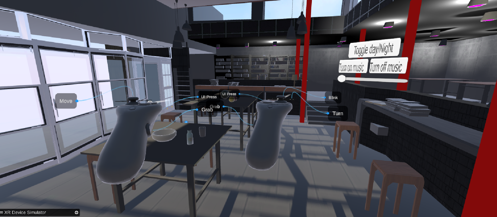
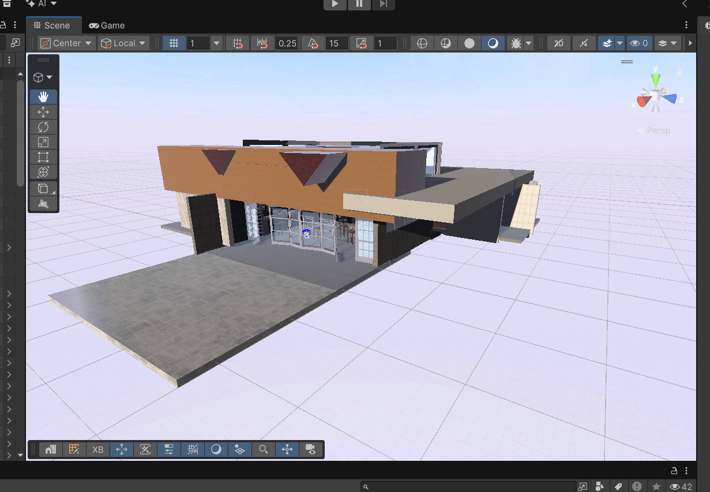
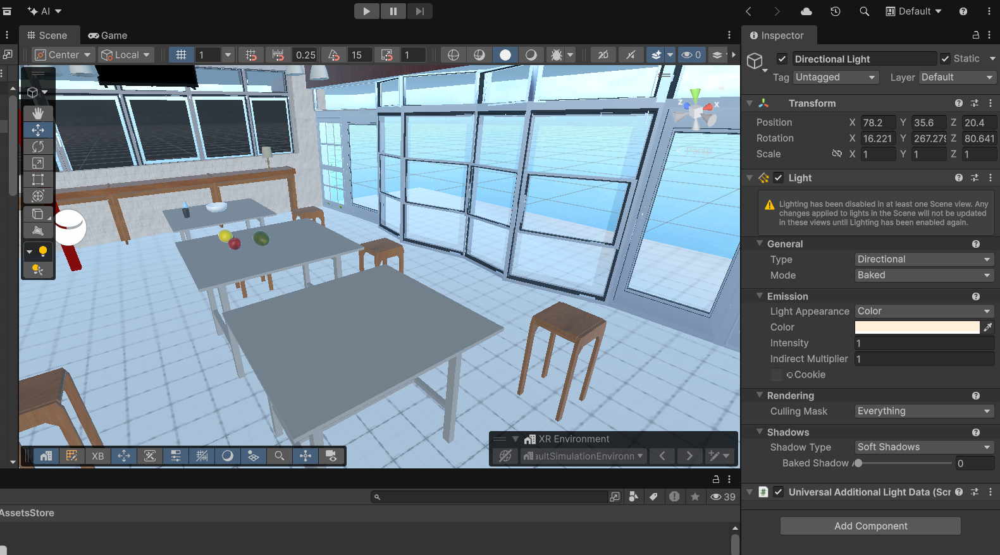
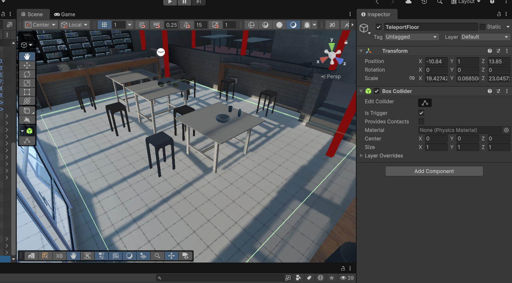

# PublicSpace

PublicSpace is an interactive VR digital twin of a shared indoor space, built in Unity for the **Interactive Public Space** XR assignment. The recreation uses 15 reference photos that document the entrance, glazed partitions, red columns, shelving, and communal seating.

[View the reference photos](Reference%20photos/)

## Screenshots

**Interior in the XR Device Simulator**

**Exterior in the Unity Scene view**

### Lighting before and after baking

**Before baking**

**After baking**

## What you can do

- **Explore the space.** Use the XR rig to teleport onto designated areas around the scene.
- **Move props.** Pick up, reposition, and release loose objects using XR Grab Interactable components.
- **Switch between day and night.** Aim a controller ray at the world-space control panel and select **Toggle day/Night**. The script changes the skybox, ambient color, and directional light intensity.
- **Control the music.** Use the panel to start or stop the scene's music.

The scene includes baked lightmaps. The day/night switch updates lighting settings at runtime while using the same baked lighting data.

## Open or build the Unity project

1. In Unity Hub, install **Unity 6.6 (6000.6.2f1)**. For Android builds, include **Android Build Support**, **Android SDK & NDK Tools**, and **OpenJDK**.
2. In Unity Hub, add the project folder that contains `Assets`, `Packages`, and `ProjectSettings`.
3. Let Unity resolve packages and import the project. Open `Assets/Scenes/PublicSpace.unity`.
4. To make an APK, open **File → Build Profiles**, select or create an Android profile, and verify that `PublicSpace.unity` is enabled and Android OpenXR is configured. Choose **Build** or **Build and Run**.

The project uses C#, Universal Render Pipeline (17.6.0), XR Interaction Toolkit (3.6.1), OpenXR (1.18.0), and ProBuilder (6.1.2).

## Project structure

Paths in this table are relative to the Unity project.

| Path | Contents |
| --- | --- |
| `Assets/Scenes/PublicSpace.unity` | Main scene with the environment, XR rig, teleportation areas, grabbable props, and control panel |
| `Assets/Scenes/PublicSpace/` | Baked lighting data and reflection probe asset |
| `Assets/Scripts/NightModeController.cs` | Switches between the configured day and night lighting settings |
| `Assets/Scripts/PlayMusic.cs` | Starts and stops playback on the assigned Unity AudioSource |
| `Assets/Audio/` and `Assets/Day-Night Skyboxes/` | Audio and skybox assets |
| `Packages/manifest.json` and `ProjectSettings/` | Unity dependencies, editor version, and project configuration |

## Author

Justice Dedume
